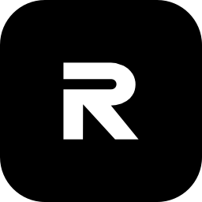

# MRTT

**Туннель через TURN-серверы звонков VK**

Android-клиент и сервер на основе [CSQTT](https://github.com/amurcanov/csqtt). Клиент поднимает VPN на устройстве и передаёт трафик через TURN-серверы звонков VK, сервер принимает его на VPS. Сейчас в релизах лежат сборки CSQTT 2.5.0 Legacy и 2.1.9 Legacy. В разработке поддержка MAX и Jitsi.

## Скачать

| Релиз | Что внутри |
|---|---|
| [v2.5.0-legacy](https://github.com/ttrroyy/mrtt/releases/tag/v2.5.0-legacy) | Основная версия |
| [v2.1.9-legacy](https://github.com/ttrroyy/mrtt/releases/tag/v2.1.9-legacy) | Для серверов на 2.1.9 |

В каждом релизе есть APK для arm64-v8a, armeabi-v7a, x86_64 и универсальный, а также серверы `csqtt-linux-amd64`, `csqtt-linux-arm64` и `csqtt-linux-armv7`. Нужен Android 8.0 или новее.

## Деплой сервера

Сервер разворачивается на VPS по SSH прямо из приложения. Серверы для amd64, arm64 и armv7 и установочный скрипт лежат внутри APK, поэтому приложение ничего не скачивает с GitHub. После установки оно выдаёт ссылку на подключение.

Сервер можно поставить и вручную: файл под нужную архитектуру есть в релизе, а в `csqtt.server-provenance.json` записаны его SHA-256 и параметры сборки.

## Другие клиенты

Профили CSQTT поддерживают [qThroneMobile](https://github.com/ttrroyy/qThroneMobile) для Android и [qThrone](https://github.com/ttrroyy/qThrone) для Windows, Linux и macOS. В обоих можно выбрать версию 2.5.0 или 2.1.9 и развернуть сервер 2.5.0.

## Лицензия

[PolyForm Noncommercial 1.0.0](LICENSE). Код можно использовать, изменять и распространять только в некоммерческих целях. Любая продажа, платные сервисы и другое коммерческое использование без письменного разрешения автора CSQTT запрещены.

Required Notice: Copyright 2026 amurcanov.
Required Notice: Commercial use of CSQTT requires a separate written license from the licensor.
Required Notice: Redistributions and derivative works must retain attribution to the original CSQTT project and these notices.

## Благодарности

- [amurcanov/csqtt](https://github.com/amurcanov/csqtt): автор CSQTT, клиента и сервера, на которых построен MRTT

## Обсуждение

[Группа в Telegram](https://t.me/raw_comm)
